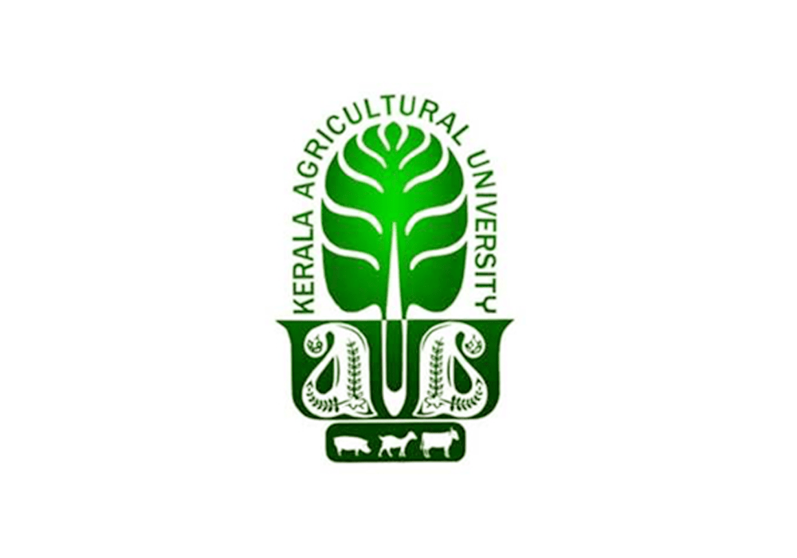
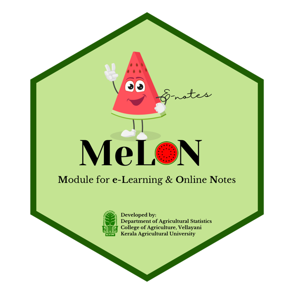

# Welcome {.unnumbered}

Welcome to *Decision Making and Problem Solving in Extension Organisations*, the online course book for the **Post Graduate Diploma in Agricultural Extension Management (PGDAEM)** offered through the Central Training Institute, Mannuthy, Kerala Agricultural University.

Every extension worker is, at heart, a decision maker and a problem solver. Which programme should be funded this year? Why did farmers not adopt a technology that worked so well in on-station trials? How should a team respond to a pest outbreak that no recommendation yet covers? This book brings together the concepts, theories, models and tools that help extension managers answer such questions systematically rather than by habit or guesswork.

### Author {.unnumbered}

::: {.grid}
::: {.g-col-12 .g-col-md-3 style="text-align:center"}
{width="110px" fig-alt="Kerala Agricultural University logo"}
:::
::: {.g-col-12 .g-col-md-9}
**Smija P K**\
Assistant Professor (Agricultural Extension Education)\
Central Training Institute, Mannuthy\
Thrissur 680 651, Kerala\
Kerala Agricultural University
:::
:::

### The course at a glance {.unnumbered}

: Course details {#tbl-course .bordered}

| | |
|:--|:--|
| **Programme** | Post Graduate Diploma in Agricultural Extension Management (PGDAEM) |
| **Course** | Decision Making and Problem Solving in Extension Organisations |
| **Prepared by** | Smija P K, Assistant Professor (Agricultural Extension Education) |
| **Institution** | Central Training Institute, Mannuthy, Kerala Agricultural University, Thrissur |

### About this book {.unnumbered}

The book is organised in three parts. **Part I** introduces decision making in agriculture and extension organisations, its cognitive basis, decision making under certainty, risk and uncertainty, group decision making and the main theories of decision making. **Part II** covers the methodologies used to structure decisions. **Part III** deals with problem solving: its nature in agriculture and extension, process frameworks, classic models, organisational and creativity-based techniques, and the statistical and graphical tools used to diagnose problems.

### How to use this book {.unnumbered}

1. Read each chapter **before** the corresponding class (see the class schedule in [About the course](preface.qmd)), so that class time can be spent on discussion and exercises.
2. Work through the agricultural examples and case studies in the shaded boxes; they show how each idea applies in the field.
3. Use the **Chapter Summary** at the end of each chapter for revision. Answers to the fill-in-the-blank questions are given at the end of every chapter.

### Citations {.unnumbered}

In-text citations and the consolidated list of [References](references.qmd) follow the APA style (7th edition). Every citation in the text links to its entry in the reference list.

### Published on MeLON {.unnumbered}

::: {.grid}
::: {.g-col-12 .g-col-md-3 style="text-align:center"}
{width="130px" fig-alt="MeLON logo"}
:::
::: {.g-col-12 .g-col-md-9}
This book is published on **MeLON** (Module for e-Learning & Online Notes), the online learning platform of Kerala Agricultural University. MeLON makes course notes freely available to students as online books that can be read on any device.
:::
:::

### Copyright Information {.unnumbered}

The online edition is licensed under the [Creative Commons Attribution–NonCommercial–NoDerivatives 4.0 International licence](https://creativecommons.org/licenses/by-nc-nd/4.0/), as stated in the footer.
