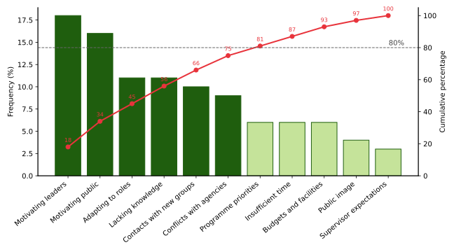
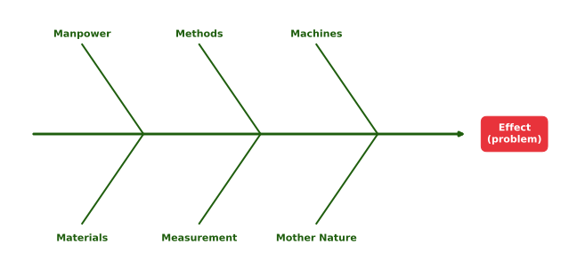

# Statistical and graphical methods and the E5 framework for problem solving {#sec-stattools}

This chapter introduces the data-based tools used to define, measure and diagnose problems — Voice of the Customer, Critical to Quality measures, line graphs, control charts, Pareto charts, the fishbone diagram and the 5 Whys — together with the development of countermeasures, the Balanced Scorecard, personality-based problem-solving preferences and the E5 framework for organisational problem solving.

## Why these tools are introduced here {#sec-why-tools}

The statistical and graphical tools in this chapter — control charts, Pareto charts and fishbone diagrams — originate from quality improvement traditions, particularly **Total Quality Management (TQM)** and **Six Sigma** [@deming1986; @juran1951]. They are included here not to import Six Sigma as a separate subject, but because these tools are the most widely validated methods for the measurement and root-cause-analysis phases of problem solving — essential disciplines for any organisation, including agricultural extension. The Six Sigma **DMAIC** cycle (Define → Measure → Analyse → Improve → Control) provides a logical organising framework showing which tool belongs to which phase of problem diagnosis (@tbl-dmaic, @fig-dmaic).

: The DMAIC cycle and the tools covered in this chapter {#tbl-dmaic .bordered}

| Phase | Core question | Tools covered |
|:------|:--------------|:--------------|
| Define | What is the problem? What do customers need? | Voice of the Customer; CTQ measures |
| Measure | How bad is the current situation? What is the baseline? | Line graphs; control charts |
| Analyse | What are the root causes? | Pareto charts; fishbone diagram; 5 Whys |
| Improve | What countermeasures eliminate the root causes? | Countermeasure development |
| Control | How do we sustain the improvement? | Control charts; Balanced Scorecard |

```{mermaid}
%%| label: fig-dmaic
%%| fig-cap: "The DMAIC cycle."
flowchart LR
  D[Define] --> M[Measure] --> A[Analyse] --> I[Improve] --> C[Control]
  C -. new problem .-> D
```

## Voice of the Customer (VOC) {#sec-voc}

The **Voice of the Customer (VOC)** is a structured process of capturing the expressed and latent needs, expectations and complaints of those served. In agricultural extension, the direct customers are the farmers who receive advisory services; indirect customers include government departments, funders and communities. VOC data are gathered through interviews, focus groups, surveys, direct observation and complaint analysis. Raw data are processed to extract specific **customer requirements** — statements of what is needed, free of solution language — which are then translated into measurable specifications through CTQ analysis.

## Critical to Quality (CTQ) measures {#sec-ctq}

**CTQ measures** translate qualitative customer language — 'I want faster advice' — into quantitative operational targets — 'Response within 48 hours in 95% of cases.' There are three levels:

1. **Customer requirement** — what the farmer expresses;
2. **Drivers** — the key dimensions that underlie the requirement; and
3. **CTQ measure** — a specific, measurable standard for each driver.

Without CTQ measures, quality improvement efforts lack direction and measurable targets.

## Line graphs {#sec-line-graphs}

A **line graph** plots data points collected at regular intervals and connects them sequentially, making trends, patterns and turning points immediately visible. In problem analysis, line graphs display baseline performance, monitor the trajectory of a problem and visualise the effect of an intervention. Upward or downward trends, flat lines, sudden spikes and cyclical patterns each carry a distinct diagnostic meaning. In agricultural extension, many problems have seasonal signatures that a line graph immediately reveals.

## Control charts (statistical process control) {#sec-control-charts}

Invented by Walter A. Shewhart at Bell Laboratories in the 1920s [@shewhart1931], the **control chart** is the most analytically powerful graphical tool in this chapter. Its value lies in distinguishing two fundamentally different types of variation:

- **Common cause variation:** predictable, inherent variation that is always present in any process — the normal output of the existing system. It does not require corrective action; it requires system-level redesign if it is deemed unsatisfactory. Treating common cause variation as special cause variation creates instability and wastes effort [@deming1986].
- **Special cause variation:** unusual, sporadic variation triggered by a specific, identifiable external factor, which appears as data points outside the control limits. It demands investigation and correction.

::: {.callout-note title="Control limit calculation"}
$$
\text{CL} = \bar{x}, \qquad \text{UCL} = \bar{x} + 3s, \qquad \text{LCL} = \bar{x} - 3s
$$

where $\bar{x}$ is the mean of all data points (the Centre Line) and $s$ is the standard deviation.

**Worked example:** average agent visit time = 24.9 min; standard deviation = 6.9 min.

- UCL = 24.9 + (3 × 6.9) = 24.9 + 20.7 = **45.6 min**
- LCL = 24.9 − (3 × 6.9) = 24.9 − 20.7 = **4.2 min**

Any day outside these limits is a special cause requiring investigation.
:::

## Pareto charts {#sec-pareto}

The **Pareto principle** — that approximately 80% of effects arise from 20% of causes — guides practitioners to focus limited resources on the 'vital few' causes rather than dispersing effort across all possible causes [@juran1951]. A Pareto chart displays categories of causes in descending order of frequency (bars on the left Y-axis) with a cumulative percentage line (right Y-axis) that rises from left to right. Categories to the left of the 80% threshold on the cumulative line are the **vital few** — the highest-leverage improvement targets. Stratification using a second Pareto chart then breaks the biggest category into sub-causes, connecting directly to the fishbone diagram.

@fig-pareto applies the method to the problems reported by county extension agents in West Virginia (@tbl-west-virginia).

{#fig-pareto fig-alt="Pareto chart with eleven bars in descending order from motivating leaders (18%) to meeting supervisor expectations (3%), and a rising cumulative percentage line crossing 80% at the seventh category (81%)."}

## Fishbone (Ishikawa) diagram {#sec-fishbone}

The **fishbone diagram** systematically maps all potential causes of a problem, with the problem (the 'effect') at the right and categories of potential causes branching off a central spine [@ishikawa1990]. Kaoru Ishikawa formalised the technique at the Kawasaki shipyards; Mazda later used it proactively during the design of the Miata (MX-5) to prevent problems before they occurred. The most widely used framework is the **6Ms**: Manpower, Methods, Machines, Materials, Measurement and Mother Nature (environment) (@fig-fishbone). The fishbone is built by:

1. defining the effect;
2. selecting a category framework;
3. identifying the biggest contributor from the Pareto chart;
4. brainstorming sub-causes using the 5 Whys; and
5. prioritising candidate causes for data verification.

{#fig-fishbone fig-alt="Fishbone diagram with a horizontal spine ending in a box labelled Effect (problem), and six angled bones labelled Manpower, Methods, Machines, Materials, Measurement and Mother Nature."}

## The 5 Whys technique {#sec-5whys}

Developed by Sakichi Toyoda and central to the Toyota Production System [@ohno1988], the **5 Whys** technique peels back layers of causation by asking 'Why?' repeatedly until an actionable root cause — not merely a symptom — is reached.

::: {.callout-tip title="5 Whys example"}
**Problem:** ran through a red light.

1. Why? → Late for work.
2. Why? → Woke up late.
3. Why? → The alarm did not work.
4. Why? → The battery was exhausted.
5. Why? → Forgot to check it.

**Root cause:** no routine for maintaining personal equipment. **Countermeasure:** a monthly calendar reminder to check the alarm battery.

**Lesson:** what appeared to be a traffic violation was a failure of a personal maintenance habit. Issues that seem technical frequently turn out to be human and process problems.
:::

Unvalidated root causes lead teams to pursue worthless countermeasures, wasting time and resources. Root causes identified through diagramming and questioning must therefore be **verified with actual data** (correlation analysis, designed experiments or stratified data analysis) before countermeasures are developed.

## Developing and evaluating countermeasures {#sec-countermeasures}

A **countermeasure** is a targeted action designed to eliminate a confirmed root cause. Each candidate countermeasure is evaluated against two criteria:

1. **Effectiveness** — how completely and permanently does it prevent the root cause from recurring?
2. **Feasibility** — how practical is it given the available resources, time and capacity?

Countermeasures are plotted on a two-axis prioritisation matrix; those scoring high on both axes are immediate priorities. After implementation, control charts and line graphs confirm whether improvement has occurred. If it has, the new process is **standardised** — documented, trained and embedded in operating procedures to prevent regression.

## The Balanced Scorecard (BSC) {#sec-bsc}

Developed by @kaplan1992, the **Balanced Scorecard** translates organisational vision and strategy into performance measures across four perspectives:

- **Financial:** how do we appear to funders?
- **Customer/farmer:** how do we appear to those we serve?
- **Internal process:** what processes must we excel at?
- **Learning and growth:** how will we sustain our capacity?

The BSC ensures that operational improvements from TQM tools are aligned with strategic intent — diagnosing what is broken and fixing it in a way that advances organisational goals.

## Personality types and problem-solving preferences {#sec-mbti}

Research using the **Myers–Briggs Type Indicator (MBTI)** demonstrates that different personality dimensions align with distinct problem-solving strategies [@huitt1992]. Extroverts prefer brainstorming and thinking aloud; introverts prefer private reflection and incubation. Sensing types favour inductive reasoning from facts; intuitive types prefer deductive reasoning and visualisation. Thinking types gravitate toward analysis and task breakdown; feeling types toward values clarification. Judging types prefer evaluation and backward planning; perceiving types prefer brainstorming and taking another's perspective. For extension facilitators, this means structuring groups for cognitive diversity, allowing individual idea generation before group discussion, and recognising that different phases of problem solving benefit from different personality orientations.

## The E5 framework: a comprehensive organisational problem-solving model {#sec-e5}

The **E5 framework** provides a structured, five-phase approach to solving complex organisational problems. It is distinguished by its emphasis on deep problem understanding before solution development — the most common failure point in organisational problem solving (@tbl-e5).

: Phases of the E5 framework {#tbl-e5 .bordered}

| Phase | Name | Core activity | Key tools |
|:-----:|:-----|:--------------|:----------|
| 1 | Expand | Framestorming — explore the problem from every angle before committing to any definition; diverse team; 'What if…?' and 'How might we…?' questions | Six Thinking Hats; brainstorming; VOC |
| 2 | Examine | Identify root causes via the Iceberg Model: surface events → patterns → systemic structures → mental models | Fishbone diagram; 5 Whys; Pareto charts |
| 3 | Empathize | Map all stakeholders; create empathy maps (Say/Think/Feel/Do); conduct interviews to gather real perspectives | Empathy mapping; stakeholder analysis |
| 4 | Elevate | Apply the Four-Frame Model (structural, human resources, political, symbolic) to connect the problem to organisational dynamics | Bolman and Deal's Four-Frame Model |
| 5 | Envision | Design the future through backcasting: ideal future state → required milestones → prioritised action plan | Backcasting; Balanced Scorecard |

The **Iceberg Model** used in the Examine phase draws on systems thinking (@sec-systems-thinking), in which visible events are traced to underlying patterns, structures and mental models [@senge1990].

### The Four-Frame Model in the Elevate phase

The Four-Frame Model [@bolman2017] diagnoses organisational problems from four complementary perspectives:

- **Structural:** systems, roles, hierarchies and coordination mechanisms. Problems are diagnosed as misaligned structures or unclear roles.
- **Human resources:** people's needs, motivations and relationships. Problems are diagnosed as unmet needs, skill gaps or leadership failures.
- **Political:** power, interests, coalitions and competition for resources. Problems are diagnosed as conflicts of interest or power imbalances.
- **Symbolic:** culture, values, rituals and shared meanings. Problems are diagnosed as cultural misalignment or erosion of trust.

### Case study: Omega Soundscapes

::: {.callout-tip title="Case study: Omega Soundscapes"}
Omega Soundscapes, a premium headphone manufacturer, experienced a significant decline in sales. Leadership assumed that a recent price increase was the cause. Applying the E5 framework revealed the following:

- **Expand:** framestorming generated alternative explanations, including quality decline, competition and brand perception.
- **Examine:** the Iceberg Model uncovered that a cost-cutting decision had substituted cheaper components and that brand overconfidence had reduced quality monitoring.
- **Empathize:** empathy maps showed customers, distributors and investors all experiencing different manifestations of declining perceived value.
- **Elevate:** the Four-Frame analysis revealed structural coordination failures between R&D and marketing, declining sales-team morale, rigid financial policies overriding quality concerns, and a gap between the brand's self-image and customer experience.
- **Envision:** the team set a goal of 10% sales recovery within 12 months and backcasted a phased plan — quality audits and restoration (months 1–3), brand campaigns and R&D–marketing integration (months 4–8), and new product launches and distributor rebuilding (months 9–12).
:::

::: {.callout-important title="Key reminder"}
Problem solving is not a straight line. New information at any phase may require returning to an earlier phase. The value of the E5 framework lies not in rigid sequence compliance but in the discipline of comprehensive problem understanding before commitment to a solution.
:::

## Summary: problem-solving models at a glance {#sec-ps-summary}

The models and concepts covered in Chapters [-@sec-ps] to [-@sec-stattools] are summarised in @tbl-ps-glance.

: Problem-solving models and concepts at a glance {#tbl-ps-glance .bordered}

| Section | Model / concept | Key author(s) | Core contribution |
|:--------|:----------------|:--------------|:------------------|
| @sec-problem | Problematic situation | @linhart1976 | Static versus dynamic problem contexts; agricultural problems are inherently dynamic |
| @sec-ps-ext | Five-step problem-solving process | @bormann1988 | Sequential framework; highlights people-problems and the danger of mental set |
| @sec-ps-agri | Group problem solving and systems thinking | @checkland1981; @adams2009 | Collective, participatory process within complex agricultural systems |
| @sec-ps-vs-dm | Problem solving versus decision making | @simon1960; @kahneman2011 | Clarifies the relationship; distinguishes programmed from non-programmed decisions |
| @sec-reflective | Reflective thinking model | @dewey1933 | Seven-step cyclical inquiry; evidence-based analysis and follow-up monitoring |
| @sec-socratic | Socratic / dialectical model | Socrates | Questioning, contradiction and synthesis as routes to creative understanding |
| @sec-problem-space | Problem space model | @newell1972 | Problem solving as heuristic search; expert chunking; limited working memory |
| @sec-six-hats | Six Thinking Hats | @debono1985 | Parallel thinking in six modes; reduces conflict; enriches group analysis |
| @sec-brainstorming | Brainstorming | @osborn1953 | Quantity-first idea generation; psychological safety; three approaches |
| @sec-creativity | Lateral thinking and cognitive biases | @debono1970; @kahneman2011 | Deliberate departure from vertical thinking; awareness and correction of biases |
| @sec-voc – @sec-countermeasures | VOC, CTQ, control charts, Pareto, fishbone | @shewhart1931; @juran1951; @ishikawa1990 | Data-based tools for defining, measuring and diagnosing problems |
| @sec-bsc – @sec-e5 | Balanced Scorecard and E5 framework | @kaplan1992; @bolman2017 | Strategic alignment and comprehensive organisational problem solving |

## Chapter Summary

### Fill in the blanks {.unnumbered}

Answers are given at the end of the chapter.

1. The five phases of the Six Sigma DMAIC cycle are Define, Measure, Analyse, Improve and __________.
2. CTQ stands for Critical to __________.
3. The control chart was invented by Walter A. __________.
4. Variation that appears as points outside the control limits is called __________ cause variation.
5. If the mean is 24.9 min and the standard deviation 6.9 min, the upper control limit is __________ min.
6. The Pareto principle states that about 80% of effects arise from __________% of causes.
7. The 5 Whys technique is central to the __________ Production System.
8. The Balanced Scorecard was developed by Kaplan and __________.
9. The fourth phase of the E5 framework, which applies the Four-Frame Model, is called __________.

### Short-answer questions {.unnumbered}

1. Explain the DMAIC cycle and the tools used in each phase.
2. How are Voice of the Customer data translated into CTQ measures? Give an extension example.
3. Distinguish between common cause and special cause variation. How are control limits calculated?
4. Explain how a Pareto chart is constructed and interpreted.
5. Describe the steps in constructing a fishbone diagram using the 6M framework.
6. Illustrate the 5 Whys technique with an example from extension work. Why must root causes be verified with data?
7. Explain the four perspectives of the Balanced Scorecard.
8. Describe the five phases of the E5 framework, using the Omega Soundscapes case.

### Quick revision {.unnumbered}

- DMAIC → Define (VOC, CTQ), Measure (line graphs, control charts), Analyse (Pareto, fishbone, 5 Whys), Improve (countermeasures), Control (control charts, BSC).
- CTQ → customer requirement → drivers → measurable standard.
- Control chart (Shewhart) → CL = mean; UCL/LCL = mean ± 3 SD; common vs special cause.
- Pareto (Juran) → 80/20; vital few left of the 80% cumulative line.
- Fishbone (Ishikawa) → 6Ms: Manpower, Methods, Machines, Materials, Measurement, Mother Nature.
- 5 Whys (Toyoda; Toyota) → ask why until an actionable root cause; verify with data.
- Countermeasures → effectiveness × feasibility; standardise what works.
- BSC (Kaplan and Norton) → financial, customer, internal process, learning and growth.
- E5 → Expand, Examine, Empathize, Elevate, Envision.

### Answers to fill in the blanks {.unnumbered}

::: {.answer-key}
`1.` Control `2.` Quality `3.` Shewhart `4.` special `5.` 45.6 `6.` 20 `7.` Toyota `8.` Norton `9.` Elevate
:::
